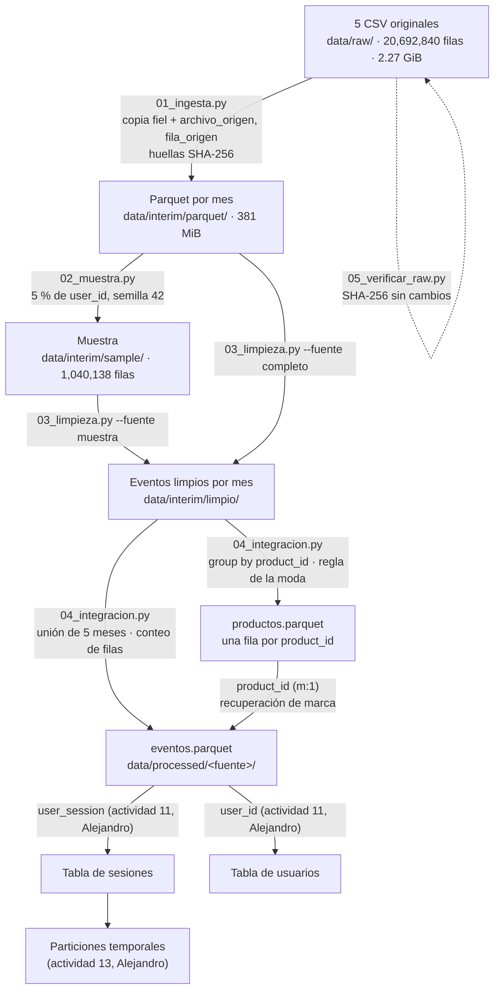

# Fase 2: preparación de los datos (parte de Gabriela)

Este documento cubre el paso previo «muestra de trabajo» y las actividades 9, 10 y 14 de
la guía. Sirve de insumo para el diccionario de datos y el diagrama de flujo (Rodrigo) y
para las tablas de sesiones, usuarios y particiones (Alejandro).

## 1. Muestra de trabajo (paso previo)

- Incluye al 5 % de los usuarios con **todos** sus eventos. Se eligen usuarios y no filas,
  para no partir sesiones.
- Selección reproducible: entra el usuario cuyo SHA-256 de `"42:<user_id>"`, convertido a
  un número entre 0 y 1, es menor que 0.05. No depende de la versión de ninguna librería.
- Resultado: 81,767 de 1,639,358 usuarios (4.99 %) y 1,040,138 eventos. La distribución de
  tipos de evento, los faltantes y el precio coinciden con el total
  (`reports/tablas/02_representatividad_muestra.csv`).

## 2. Actividad 9: estandarización (`src/03_limpieza.py`)

| Elemento | Regla | Justificación |
|---|---|---|
| `event_time` | Texto `"AAAA-MM-DD hh:mm:ss UTC"` → `Datetime` con zona UTC. Si una fecha no se puede convertir, el script se detiene | La fuente registra en UTC. Como no indica el país, no se convierte a hora local |
| `fecha`, `hora`, `dia_semana` | Derivadas de `event_time`. `dia_semana`: 1 = lunes … 7 = domingo | Las necesita el análisis del embudo por día y hora (P1). Las horas son UTC |
| `category_code` | Se divide por `.` en `categoria_nivel_1`, `_2` y `_3`. Nulo → `"unknown"` en los tres niveles; un nivel que no existe queda vacío | 98.3 % de los eventos no tiene código; la categoría principal para el análisis es `category_id` |
| Textos | `event_type`, `category_code` y `brand` en minúsculas y sin espacios sobrantes | Se verificó que ya venían así: 0 valores cambiaron |
| Nombres de columnas | Las 9 originales ya estaban en snake_case y se conservan; las nuevas también van en snake_case | Trazabilidad con la fuente |
| Tipos | `event_type` → Enum; `product_id` y `user_id` → Int32; `brand`, `category_code` y niveles → Categorical; `archivo_origen` → Enum | En la muestra, las 9 columnas originales pasan de 100.8 a 76.6 MiB en memoria (24 % menos) |

### Decisiones de la actividad 8 aplicadas por defecto

Rodrigo define la decisión final. Mientras tanto, **no se elimina ninguna fila**: cada
problema queda marcado con una bandera, para medir su efecto antes de decidir.

| Problema | Bandera | Por defecto | Para cambiarlo |
|---|---|---|---|
| Duplicado exacto (9 columnas iguales, mismo mes) | `es_duplicado_exacto` (2.ª aparición en adelante), `repeticiones_exactas` | Marcar | `DECISIONES["eliminar_duplicados_exactos"] = True` |
| Sesión nula | `sesion_nula` | Marcar | `DECISIONES["eliminar_sesion_nula"] = True` |
| Precio 0 / negativo | `precio_cero`, `precio_negativo` | Marcar | — |
| Marca nula | `marca_nula_original` | Recuperar desde el producto (sección 3) | `DECISIONES["recuperar_marca_desde_producto"] = False` |
| Categoría textual nula | `categoria_code_nula` | `"unknown"` | — |

`DECISIONES` está en `src/config.py`. Si se activa una eliminación, el resumen
`reports/tablas/03_resumen_limpieza_<fuente>.csv` registra cuántas filas se eliminaron.

## 3. Actividad 10: integración (`src/04_integracion.py`)

### Llaves

| Desde | Hacia | Cardinalidad | Nota |
|---|---|---|---|
| `eventos.product_id` | `productos.product_id` | muchos a uno | Se verifica con `validate="m:1"` |
| `eventos.user_session` | sesión | muchos a uno | Las sesiones nulas no se unen |
| `eventos.user_id` | usuario | muchos a uno | — |

### Reglas

1. **Unión de meses.** Los cinco meses deben tener columnas y tipos idénticos. Cada archivo
   solo trae fechas de su mes y los rangos no se superponen. Filas de la unión = suma de
   los meses.
2. **Tabla de productos (una fila por `product_id`).** Para un producto con varias
   categorías o marcas se toma **la más frecuente**. Si hay empate, la del evento más
   reciente y, si persiste, el valor menor. Se verifica que `product_id` quede único.
3. **Recuperación de marca.** Un evento sin marca toma la marca de su producto **solo si el
   producto tiene una única marca conocida**. Con varias marcas no se adivina. Lo que
   sigue sin marca queda como `"unknown"`, con la bandera `marca_desconocida`.
4. **Sesiones.** `sesion_multiusuario` marca las sesiones con más de un `user_id`. Además se
   cuentan las sesiones que cruzan de un mes a otro.
5. **Cardinalidad.** Se cuentan las filas antes y después de cada unión; si no coinciden,
   el script se detiene. Todas las verificaciones quedan en
   `reports/tablas/04_verificaciones_integracion_<fuente>.csv`.

### Resultados en la muestra

| Verificación | Muestra |
|---|---|
| Columnas y tipos idénticos en los 5 meses | OK (24 columnas) |
| Eventos fuera del mes de su archivo | 0 |
| Meses con fechas superpuestas | 0 |
| Filas: suma de meses = unión = guardadas | 1,040,138 en los tres casos |
| Productos (únicos) | 41,371 |
| Productos con varias categorías / varias marcas / sin marca | 1,024 / 15 / 17,813 |
| Productos que solo tienen precio negativo | 3 |
| Eventos sin marca → recuperados → quedan `"unknown"` | 437,298 → 4,315 → 432,983 |
| Duplicados exactos marcados | 55,563 (5.3 %) |
| Sesiones que cruzan de un mes a otro | 775 |
| Sesiones con más de un usuario | 0 (es lo esperado: la muestra se toma por usuario) |

Con los datos completos, las cifras se regeneran solas en `reports/tablas/*_completo.csv`.
Según el diagnóstico del equipo deberían salir 1,619 productos multicategoría,
24 multimarca, 98,300 marcas recuperadas, 272 sesiones multiusuario y 1,109,098
duplicados.

## 4. Actividad 14: reproducibilidad

- `data/raw/` no se modifica nunca. `src/05_verificar_raw.py` recalcula la huella SHA-256
  de cada CSV y la compara con la registrada en la ingesta
  (`reports/tablas/01_huellas_sha256_raw.csv`).
- Un solo comando va de los CSV al dataset final: `python src/run_pipeline.py`.
  `--fuente muestra` sirve para la prueba rápida.
- `notebooks/02_preparacion.ipynb` explica y ejecuta cada paso.
- Versiones de las librerías en `requirements.txt`. Instrucciones en `README.md`.
- Se probó desde cero en un entorno limpio: instalación con `requirements.txt`, proceso
  con la muestra y notebook, sin errores. La ejecución con los datos completos se hace en
  la computadora donde están los CSV (`python src/run_pipeline.py`) y sus verificaciones
  quedan en `reports/tablas/*_completo.csv`.

## 5. Flujo de integración y transformación (insumo para el diagrama)

Se puede pegar en <https://mermaid.live> o redibujar en draw.io.

## 6. Columnas del dataset preparado (insumo para el diccionario de datos)

### `eventos.parquet` (una fila por evento)

| Atributo | Descripción | Tipo | Unidad / categorías | Origen | Tratamiento aplicado |
|---|---|---|---|---|---|
| `event_time` | Momento del evento | Datetime (UTC) | fecha-hora UTC | Original | Texto → fecha-hora UTC |
| `event_type` | Tipo de evento | Enum | view, cart, remove_from_cart, purchase | Original | Minúsculas; tipo Enum |
| `product_id` | Identificador del producto | Int32 | — | Original | Tipo Int32 |
| `category_id` | Identificador de la categoría del producto en ese evento | Int64 | — | Original | Sin cambios |
| `category_code` | Código textual de la categoría | Categorical | p. ej. `appliances.environment.vacuum`; `unknown` | Original | Minúsculas; nulo → `unknown` |
| `brand` | Marca | Categorical | 266 marcas en la muestra; `unknown` | Original | Minúsculas; marca recuperada desde el producto; nulo restante → `unknown` |
| `price` | Precio del producto en el evento | Float64 | moneda no indicada por la fuente | Original | Sin cambios (anomalías marcadas) |
| `user_id` | Identificador seudónimo y permanente del usuario | Int32 | — | Original | Tipo Int32 |
| `user_session` | Identificador temporal de la sesión | String | UUID | Original | Sin cambios (nulas marcadas) |
| `fecha` | Fecha del evento | Date | AAAA-MM-DD (UTC) | Derivada de `event_time` | — |
| `hora` | Hora del evento | Int8 | 0–23 (UTC) | Derivada de `event_time` | — |
| `dia_semana` | Día de la semana | Int8 | 1 = lunes … 7 = domingo | Derivada de `event_time` | — |
| `categoria_nivel_1` … `_3` | Niveles de `category_code` | Categorical | `unknown` si no hay código; vacío si el nivel no existe | Derivada de `category_code` | División por `.` |
| `es_duplicado_exacto` | La fila repite a otra anterior en las 9 columnas originales | Boolean | — | Bandera | La primera aparición queda en `false` |
| `repeticiones_exactas` | Cuántas veces aparece esa misma fila en el mes | UInt32 | ≥ 1 | Bandera | — |
| `precio_cero` / `precio_negativo` | Precio = 0 / precio < 0 | Boolean | — | Bandera | — |
| `sesion_nula` | El evento no tiene `user_session` | Boolean | — | Bandera | — |
| `marca_nula_original` | El evento venía sin marca | Boolean | — | Bandera | — |
| `marca_recuperada` | La marca se tomó del producto | Boolean | — | Bandera | Solo si el producto tiene una única marca |
| `marca_desconocida` | La marca final es `unknown` | Boolean | — | Bandera | — |
| `categoria_code_nula` | El evento venía sin `category_code` | Boolean | — | Bandera | — |
| `sesion_multiusuario` | La sesión tiene más de un `user_id` | Boolean | — | Bandera | Calculada sobre los 5 meses |
| `archivo_origen` | Mes del CSV de origen | Enum | 2019-Oct … 2020-Feb | Trazabilidad | — |
| `fila_origen` | Número de fila en el CSV de origen (desde 0, sin encabezado) | UInt32 | — | Trazabilidad | — |

### `productos.parquet` (una fila por producto)

| Atributo | Descripción | Tipo | Origen / regla |
|---|---|---|---|
| `product_id` | Identificador del producto (llave) | Int32 | Único |
| `categoria_principal` | `category_id` más frecuente | Int64 | Moda; empate → evento más reciente → valor menor |
| `categorias_distintas` | Cuántos `category_id` distintos tiene | UInt32 | — |
| `category_code_principal` | `category_code` más frecuente | String | Moda; `unknown` si no tiene |
| `marca_principal` | Marca más frecuente | String | Moda; `unknown` si no tiene |
| `marcas_distintas` | Cuántas marcas distintas tiene (sin contar nulos) | UInt32 | — |
| `eventos` / `eventos_sin_marca` | Eventos totales / sin marca original | UInt32 | — |
| `precio_mediano_positivo`, `precio_min_positivo` | Mediana y mínimo de los precios > 0 | Float64 | Excluye precios 0 y negativos |
| `precio_max` / `precios_distintos` | Precio máximo / cantidad de precios distintos | Float64 / UInt32 | — |
| `primera_aparicion` / `ultima_aparicion` | Primer y último evento del producto | Datetime (UTC) | — |
| `producto_multicategoria` / `producto_multimarca` / `producto_sin_marca` | Más de una categoría / más de una marca / ninguna marca | Boolean | — |
| `producto_marca_recuperable` | Una sola marca conocida y algunos eventos sin marca | Boolean | — |
| `producto_precio_negativo` | Todos sus precios son negativos (probable descuento o cupón) | Boolean | — |

## 7. Notas para las actividades 11 y 13 (Alejandro)

- Construir la tabla de sesiones a partir de `eventos.parquet` (los 5 meses unidos), no mes
  por mes: hay sesiones que cruzan de un mes a otro (775 solo en la muestra).
- Filtro sugerido mientras Rodrigo decide la actividad 8: excluir `es_duplicado_exacto` y
  no usar precios ≤ 0 para calcular montos.
- Las sesiones con `sesion_multiusuario` o `sesion_nula` conviene excluirlas de la tabla de
  sesiones o tratarlas aparte.
